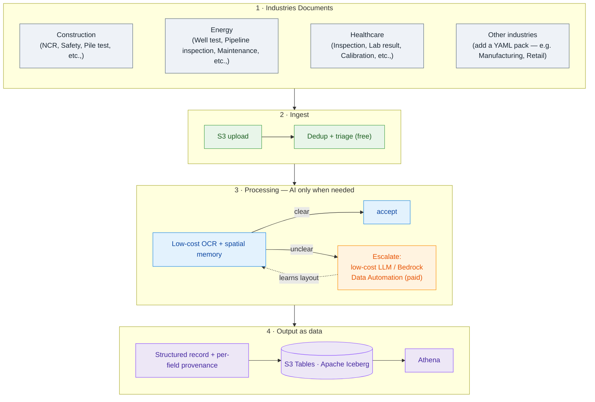
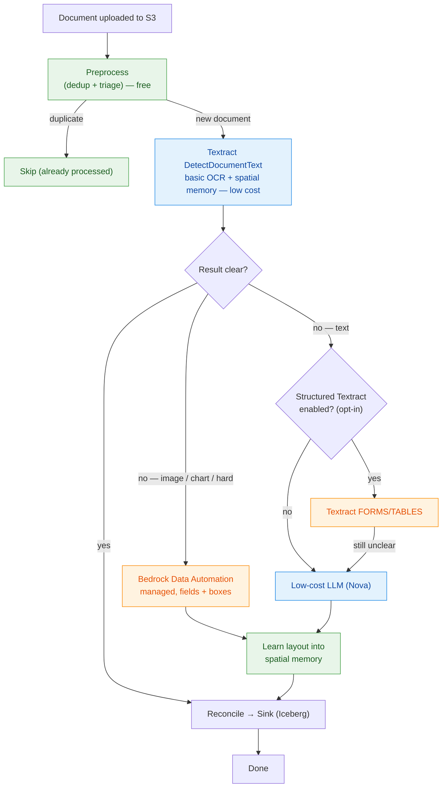
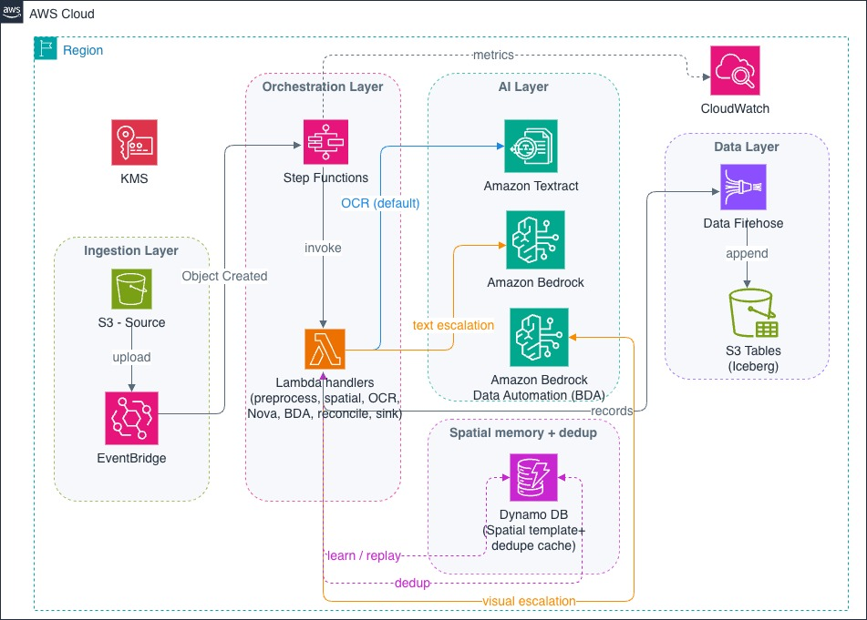
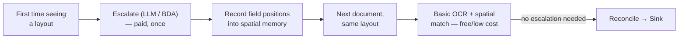

# Cost-Aware Adaptive IDP using Serverless on AWS

> A **fully serverless** intelligent document processing (IDP) reference pattern
> built on four ideas: it **learns each document layout once** (spatial memory)
> so repeat documents extract for free, calls **AI only when a document is
> unclear**, is **plug-and-play across industries** via declarative packs, and
> lands results in an **open Apache Iceberg** table (Amazon S3 Tables) with
> per-field provenance you can query in SQL.

<p align="center">
  <a href="LICENSE"></a>
  
  
  
  
  
</p>

<p align="center"><b>Plug-and-play across industries</b></p>

<p align="center">
  
  
  
</p>

<p align="center"><sub><i>Industry-agnostic engine. Ships with 3 example packs (Construction · Energy · Healthcare) and extends to any domain — e.g. Manufacturing, Automotive, Retail, Insurance, Logistics — by adding a declarative YAML pack and selecting it at deploy time, with no engine code changes.</i></sub></p>

<p align="center"><b>How it works — at a glance</b></p>



---


## Core ideas

Four ideas define this pattern:

- **Spatial memory — learn once, then reuse for free.** The first time a layout
  is seen, a paid tier (a low-cost LLM, or Bedrock Data Automation for
  images/charts) extracts it *and* returns field bounding boxes, which are
  stored as a template. Every later document of that layout is resolved by
  replaying the template over low-cost OCR — **no AI call**. Extraction gets
  cheaper the more you run it. This "learn then reuse" loop is the heart of the
  pattern.
- **Open table format by default (S3 Tables → Apache Iceberg).** Structured
  records are streamed through Amazon Data Firehose into **Amazon S3 Tables**, a
  **managed Apache Iceberg** open-table sink — no lock-in and no compaction to
  operate. Query the same data with Athena, Spark, or any Iceberg-compatible
  engine, and reuse it across teams and tools.
- **Plug-and-play across industries.** The engine has no hard-coded schema. Each
  industry is a declarative YAML **pack** (document types, per-type fields,
  linking keys, compliance rules). Switch or add an industry at deploy time —
  no engine code change.
- **Cost-aware AI usage — a repeatable IDP pattern.** Documents run low-cost OCR
  + free spatial memory first and escalate to paid AI **only when the result is
  not clear**, with per-field cost provenance written to the table. Fully
  serverless (scales to zero when idle). Modeled at an **~90% cost reduction**
  vs running structured extraction on every document — provable in SQL, not
  asserted.

---

## At a glance

| | |
|---|---|
| **What** | An adaptive IDP pipeline that **learns each layout once** (spatial memory) and reuses it for free, escalates to paid AI only when a document is unclear, is **plug-and-play per industry** (YAML packs), and outputs to an **open Iceberg table**. |
| **Why** | Most IDP stacks push every page through the highest-cost extraction. This one resolves the majority of documents at low cost and reserves AI for the documents that need it. |
| **Result** | Modeled blended cost of **~$6 per 1,000 documents** vs **~$67 per 1,000** for a "structured extraction on everything" baseline — an **~90% reduction** — with a full per-field audit trail. |
| **Stack** | Serverless AWS: S3, EventBridge, Step Functions, Lambda (Python 3.14), Textract, Bedrock + Bedrock Data Automation, DynamoDB, Firehose → S3 Tables (Apache Iceberg), Athena, CloudWatch. All CDK (Python). |
| **License** | MIT-0. Deploy it in your own account. |

---

## Important callouts

> [!WARNING]
> **This is a reference sample, not production software.** It is intended to
> teach a cost-optimization pattern and to be adapted. Review the
> [Limitations](#limitations-and-non-production-notes) section and harden it
> before any production use.

- **Not production-ready as-is.** No throttling/queue buffering, minimal error
  surfacing, permissive-but-broad IAM in a few spots, and no multi-account or
  HA hardening. See the [non-production checklist](#limitations-and-non-production-notes).
- **Generic and industry-agnostic.** The engine has no hard-coded document
  schema. Behavior for each industry is declarative YAML (an "industry pack").
  Construction ships as the flagship; energy and healthcare are also included,
  and any other industry is added by dropping in a YAML pack.
- **Built and validated for PDF source documents.** PDF is the primary,
  tested input. Common single-page image formats also flow through the OCR /
  vision path, but broader format support (multi-page image bundles, Office
  documents, email, etc.) is an intentional **extension point**, not a tested
  guarantee.
- **Open source, meant to be extended.** MIT-0. Fork it, add document types,
  swap models, wire it in front of a full extractor — it is designed as a
  starting point for your specific use case.
- **Audit retrieval is opt-in.** The S3 Object Lambda retrieval stack is not
  deployed by default because S3 Object Lambda is closed to new customers. See
  the note under [Deploy](#deploy) for how to enable it or read archived
  sources without it.

---

## Why this exists: the hidden cost of IDP

Document processing at scale has a counter-intuitive cost profile. The instinct
is "OCR is low-cost, LLMs are expensive," so teams reach for structured OCR
everywhere and add an LLM. The reality (indicative AWS list prices,
us-east-1):

| Extraction method | Indicative cost | Note |
|---|---|---|
| Textract `DetectDocumentText` (basic OCR) | **~$1.50 / 1,000 pages** | Plain text + word boxes |
| A low-cost LLM pass (e.g. Amazon Nova Lite, Converse) | **~$0.30 / 1,000 docs** | A few thousand tokens per doc |
| Bedrock Data Automation (custom output) | **~$40 / 1,000 pages** | Managed, returns fields + bounding boxes |
| Textract `AnalyzeDocument` FORMS + TABLES (structured) | **~$65 / 1,000 pages** | A common default — and the highest cost |

The headline: **structured Textract is the highest-cost extraction tier —
higher than a low-cost LLM.** A pipeline that runs structured extraction on
every page pays the highest-cost tier for documents a lower-cost method could
have handled. That is the cost this pattern removes.

---

## The core idea: spend on AI only when needed

Treat extraction as a **cost cascade**. Start with the lowest-cost deterministic
method, check whether the result is trustworthy, and **escalate only on "not
clear."** The higher-cost tiers do more than answer once — they **train** the
low-cost tier, so repeat layouts stop escalating.



**The rule of thumb the pipeline follows:**

1. **Preprocess (free).** Deduplicate by content hash. Identical re-uploads of
   a successfully processed document are never reprocessed. Files over the
   size or page limits are rejected here. No extraction, no AI.
2. **Basic OCR + spatial memory (low-cost, the default for every document).**
   `DetectDocumentText` gives text and word positions; spatial memory replays
   known layouts for free. If the result is confident, processing is complete.
3. **Escalate only when unclear:**
   - **Unstructured text →** a low-cost LLM (Amazon Nova via the Converse API)
     structures it.
   - **Images, charts, visually complex pages →** Amazon Bedrock Data Automation
     (BDA), a managed service that returns fields **with bounding boxes**.
   - **Structured Textract FORMS/TABLES** is available but **opt-in** — it is the
     highest-cost OCR mode, so it is off by default.
4. **Escalations train the low-cost tier.** Both the LLM and BDA feed what they
   learned (field positions) back into spatial memory, so the next document of
   the same layout resolves for free at step 2.

---

## How the cascade works

Every non-duplicate document runs basic OCR first; escalation tiers add their
service cost on top of that single OCR pass.

| Tier | Relative cost | When it runs | Mechanism |
|---|---|---|---|
| **Preprocess** | Free | Every upload | Content-hash dedup + routing. No extraction. |
| **Basic OCR + spatial** | Low (~$1.50/1k pg) | Every new document (default) | `DetectDocumentText` + free spatial template memory. Target tier for most docs. |
| **Low-cost LLM (text)** | Low (~$0.30/1k docs) | OCR text unclear | Bedrock Converse (Nova/Claude, configurable). Trains spatial memory from the OCR layout. |
| **Bedrock Data Automation (visual)** | Medium (~$40/1k pg) | OCR unclear + image/chart/hard | Managed extraction; returns fields **with bounding boxes** that train spatial memory. |
| **Structured Textract** | High (~$65/1k pg) | **Opt-in only** | `AnalyzeDocument` FORMS+TABLES. Enable with `-c idp:structuredTextractEnabled=true`. |

**Why Step Functions + Lambda durable functions?** The flow spans many services
(Textract, Bedrock, BDA, DynamoDB, Firehose, S3), so Step Functions is the
top-level orchestrator — native integrations, visual debugging, per-state
retries. But Textract and BDA run **asynchronously** for multi-page work. Rather
than polling in a `sleep` loop (which consumes Lambda compute and is capped by the
15-minute timeout), the async tiers are **Lambda durable functions**: they
`wait` between status checks, **suspending with no compute charge**, and report
back to Step Functions via the task-token pattern. Step Functions coordinates;
durable functions own the long wait.

---

## Architecture

<p align="center">
  
  <br>
  <em>Figure 2 — AWS Architecture</em>
</p>

### Service mapping

| Concern | Service |
|---|---|
| Ingestion + source store | Amazon S3 + Amazon EventBridge |
| Orchestration | AWS Step Functions (Standard) |
| Compute | AWS Lambda (Python 3.14); durable functions for async Textract + BDA |
| OCR (default) | Amazon Textract `DetectDocumentText` |
| Structured OCR (opt-in) | Amazon Textract `AnalyzeDocument` FORMS+TABLES |
| Text AI escalation | Amazon Bedrock (Converse API — Nova / Claude, model-configurable) |
| Visual AI escalation | Amazon Bedrock Data Automation (managed; fields + bounding boxes) |
| Spatial template store + dedup | Amazon DynamoDB (on-demand) |
| Open-table sink | Amazon Data Firehose → Amazon S3 Tables (managed Apache Iceberg) |
| Catalog + query | AWS Glue Data Catalog + Amazon Athena |
| Audit retrieval (optional, opt-in) | Amazon S3 Object Lambda Access Point (transparent decompress) |
| Archival | S3 Lifecycle (configurable: Glacier IR transition, or source expiry) |
| Security | SSE-KMS on data stores (SSE-S3 on the access-log bucket), least-privilege IAM per function |
| Observability | CloudWatch dashboard + alarms (workflow + Firehose delivery), AWS X-Ray |

---

## Spatial memory: why it gets cheaper over time

The core component of this pattern is **spatial template memory** — a self-learning
store of *where fields sit on a page* for each document layout it has seen. It's
source-agnostic: it learns from Textract OCR word boxes and from BDA's visual
grounding boxes alike.



The first document of a new layout incurs a paid escalation once. Every
subsequent document of that layout is resolved by low-cost OCR plus a free
spatial match. **The blended cost per document decreases as the pipeline learns
your document mix.**
The core idea behind the spatial engine — learn field locations once, reuse the
layout for free — is credited to the open-source
[`aws-samples/sample-textract-field-memory`](https://github.com/aws-samples/sample-textract-field-memory)
(see [Acknowledgments](#acknowledgments)). This implementation is independent
and no code was ported from it.

The memory only learns from AI-checked results, and a new layout has to earn
trust before it is reused for free (see
[Compliance verdicts and review](#compliance-verdicts-and-review)). With the
default `idp:templateConfirmations=2`, a layout is escalated about twice before
its repeats go free.

---

## Compliance verdicts and review

Every record's `compliance_result` starts with one verdict word, so
`LIKE 'FAIL%'` and `LIKE 'NEEDS_REVIEW%'` filters work.

| Verdict | Meaning |
|---|---|
| `PASS` | The rule's comparison held and every value it used is verified. |
| `FAIL` | The rule's comparison did not hold. A failing comparison stays `FAIL` even when a value is unverified. |
| `NEEDS_REVIEW` | The comparison held but used an unverified value, a value did not parse as exactly one number (for example `TBD`, `30-35`, `approx 500 or 1000`), or the Bedrock Guardrail intervened. A guardrail-blocked document has no classification and no rules, so it reads `NEEDS_REVIEW (guardrail=intervened)`; when rules apply, each is `NEEDS_REVIEW` and `guardrail=intervened` ends the list. A person should check the source document. |
| `NA` | A field the rule needs is missing from the document, or the document type has no rules. |

The overall verdict follows `FAIL > NEEDS_REVIEW > PASS > NA`: any failing rule
makes the document `FAIL`; otherwise any rule needing review makes it
`NEEDS_REVIEW`; otherwise any passing rule makes it `PASS`; otherwise `NA`.

**Grounding (which values count as verified).** A model can be steered by text
inside a supplier's document, so AI output is checked against the page:

- The Nova tier only keeps fields the active pack declares for the classified
  document type, and only scalar values. Its prompt treats the document as
  untrusted data, wraps OCR text in `<document>` tags, and asks for values
  copied verbatim.
- A Nova value is verified only when it appears in the Textract OCR text under
  the same label (`120` is found in `120 kN`; `5` is not found in `50`). With no
  OCR text, every Nova value is unverified.
- A BDA value is verified only when BDA returned a bounding box for it. A
  blueprint field that BDA left empty has nothing to verify.
- OCR and spatial values come from the page itself and are treated as verified.
- The result is stored as `grounded` in each field's entry in
  `field_provenance_json`.

**Template trust.** Spatial templates are created only from AI-checked
documents (Nova or BDA). A new template is `provisional`; it becomes `trusted`
once `idp:templateConfirmations` AI-checked documents with the same layout and
`doc_type` agree. Only a verified document counts as a confirmation: every
non-empty value it kept must be grounded (Nova) or have a bounding box (BDA).
Empty fields don't count either way. For BDA, the generated and catch-all
blueprint fields `summary`, `document_date`, `reference_number`,
`issuing_organization` and `prepared_by` are also left out of this check
(unless the pack declares the field itself), because BDA infers them and often
returns no box. A pack field that BDA returned with a value but no box still
blocks trust. These exclusions apply to template trust only; the fields keep
`grounded: false` in their provenance, and compliance and `NEEDS_REVIEW`
gating are unchanged. A document with any unverified value adds no
confirmation. It can still start a new
provisional template (with zero confirmations) or refine the regions of a
provisional template of the same `doc_type`, but it never changes a template's
`doc_type` and never touches a trusted template. Only trusted templates can
resolve a document on the free path, and the spatial tier can refine a trusted template's regions but never
creates one or changes its `doc_type`. An AI result with a different `doc_type`
resets the template to provisional.

**Spot checks.** `idp:spotCheckPercent` (default 5%) of documents that would go
free on a trusted template are sent to the AI tier instead. The AI result is
the record, and it is compared with the template: a different `doc_type`, or a
different value for a label that both the OCR text and the AI found, demotes
the template to provisional.

**Suffixes.** After the verdict and rule list, `compliance_result` carries:

- `[pack=<name>@sha256:<16 hex>]`: the pack content hash that judged it.
- `[template=<id>@<state>]`: the spatial template behind the record and its
  trust state (`provisional`, `trusted`, or `unknown`), when there is one.
- `[spot_check=agree]` or `[spot_check=disagree]`: when the document was a spot
  check.

Find documents waiting for a person with the `compliance_needs_review` Athena
named query (next to `compliance_failures`). There is no built-in review queue;
`NEEDS_REVIEW` is the hand-off point to your own review process.

**After upgrading.** Templates learned by an earlier version have no trust
state and load as `provisional`, so layouts are escalated again until they
reach `idp:templateConfirmations`. Expect a temporary rise in AI-tier cost while
the free path warms up.

---

## Provable savings: provenance in every record

Cost savings are only credible if you can measure them. Every extracted field in
the final record carries **provenance**: the method that produced it and a
confidence score.

- Free method: `spatial`
- Paid methods: `textract` (basic OCR), `textract_custom` / `table` (structured),
  `llm` (Nova/Claude), `bda`

### Open-table sink: Amazon S3 Tables (managed Apache Iceberg)

Records are ingested through **Amazon Data Firehose** into **Amazon S3 Tables**,
a fully managed **Apache Iceberg** sink. This matters for a cost-aware pattern:

- **Open format, no lock-in.** Iceberg is an open table format. The same data is
  queryable by **Amazon Athena, Apache Spark, or any Iceberg-compatible engine** —
  you're not tied to a proprietary store.
- **Managed maintenance.** S3 Tables handles Iceberg **compaction and table
  maintenance** for you, so there's no cluster or background job to operate.
- **Provenance as columns.** The schema carries scalar cost columns
  (`free_field_count`, `paid_field_count`, `mean_confidence`, method summary),
  so free-vs-paid extraction is a **direct SQL query** in Athena — the share of
  fields resolved for free, or the count of documents that never touched AI.
- **Optional object annotations.** As a companion, source objects can be tagged
  with document context (`doc_type`, `compliance`, linking keys) via the
  **opt-in** `idp:annotationsEnabled` toggle (S3 object tagging; off by default).

The savings become a number you can put on a dashboard, not a claim on a slide.

### The Iceberg table schema (14 columns)

The table has a **fixed** schema. Scalar cost columns are first-class so the
savings story is a direct SQL query; the variable-length extracted data lives in
JSON string columns.

| Column | Type | Holds |
|---|---|---|
| `doc_id` | string | Unique document id (required). |
| `doc_type` | string | Document type from the matched template / pack. |
| `source_uri` | string | `s3://…` location of the source document. |
| `content_hash` | string | SHA-256 of the source bytes (the dedup key). |
| `ingested_at` | string | ISO-8601 write timestamp. |
| `mean_confidence` | double | Average confidence across extracted fields. |
| `field_count` | int | Total fields extracted for this document. |
| `free_field_count` | int | Fields resolved by the free method (`spatial`). |
| `paid_field_count` | int | Fields that required a paid method. |
| `method_summary_json` | string | JSON map of method → count. |
| `fields_json` | string | JSON map of every field → value (variable length). |
| `field_provenance_json` | string | JSON map of field → `{method, confidence, region_bbox, grounded}` (`grounded` is set for AI values; see [Compliance verdicts and review](#compliance-verdicts-and-review)). |
| `compliance_result` | string | Pack compliance outcome (`PASS`, `FAIL`, `NEEDS_REVIEW` or `NA`), suffixed with the pack that judged it and, when used, the spatial template: `PASS (…) [pack=<name>@sha256:<16 hex>] [template=<id>@<state>]`. The verdict stays first, so `LIKE 'FAIL%'` still works. |
| `compression_algo` | string | Archival compression algorithm for the source. |

### Fields and schema evolution (no predefinition needed)

**You do not define your document's fields or columns before deploying.** The
engine learns whatever fields appear on each layout, and every extracted field
is stored in the `fields_json` column — so documents with different field counts
all fit the same fixed table.

- **Variable field counts are expected.** 100 documents with 25 fields, then 10
  with 20, then a batch with 30, all write to the same schema. Each row simply
  carries its own `field_count` and its own `fields_json`.
- **Spatial memory learns per layout.** Documents that share a layout refine one
  template (a field appearing or missing on a given document is tolerated);
  different layouts become separate templates.
- **The pack declares fields per document type**, which guide extraction and
  drive linking/compliance. On the Nova tier, fields outside the pack's list for
  the classified type are dropped, so a document can't add fields of its own.
  OCR, spatial and BDA fields are stored as found.
- **Different document types share one table.** `doc_type` distinguishes them and
  each row carries its own `fields_json`, so no schema change is needed when a
  new type has a different field set:

  | doc_type | fields_json (abbreviated) | compliance_result |
  |---|---|---|
  | `pile_test_report` | `{"pile_capacity":"120","withstand_limit":"100","concrete_strength":"35"}` | `PASS (pile_capacity_meets_withstand=PASS; ...)` |
  | `material_delivery_note` | `{"delivery_date":"2026-01-12","material_type":"C40","quantity":"18"}` | `NA` |

- **Query a field in Athena** with `json_extract_scalar(fields_json, '$.Invoice
  Number')`; use the scalar `field_count` / `paid_field_count` columns directly
  for cost metrics.

**Can the columns be changed after deployment?** Yes, but choose the right path.
Apache Iceberg supports additive schema evolution (adding columns) without
rewriting existing data — however, in this stack the table schema lives in the
`IcebergMetadata` property of `AWS::S3Tables::Table`, which is
**replace-on-update** in CloudFormation. That leads to three rules:

- **Before the first deploy (empty table):** edit `_SCHEMA` in
  `infra/sink_stack.py` freely.
- **On a live, populated table — add a column via the table engine, not the
  CDK.** Run `ALTER TABLE <namespace>.documents ADD COLUMNS (...)` in Athena (or
  Spark), then update the `flatten_for_sink` mapping in `record.py` so new
  records populate it. Existing rows read back `NULL` for the new column; no data
  is rewritten. **Do not** change `_SCHEMA` and `cdk deploy` on a table you want
  to keep — because `IcebergMetadata` requires replacement, CloudFormation would
  create a new, empty table (the original is retained under the default `RETAIN`
  policy but is no longer the write target).
- **Usually unnecessary.** Every extracted field is stored in `fields_json`, so
  changing field sets rarely requires a column change at all — query fields with
  `json_extract_scalar` instead.

---

## The cost model

A small, editable calculator (`tools/cost_model.py`) turns the cascade into
dollars. Sample output for the default mix (nova-lite, 1 page/doc):

```
Per-tier cost ($ / 1,000 docs):
  low_cost_ocr   $    1.67   (mix 70%)
  llm            $    1.99   (mix 20%)
  bda            $   41.67   (mix  8%)
  structured     $   66.67   (mix  2%)

Blended:        $    6.23 / 1,000 docs
Naive baseline: $   66.67 / 1,000 docs   (structured extraction on every doc)
Savings vs naive: ~91%
```

```bash
python tools/cost_model.py \
  --low-cost-ocr 0.70 --llm 0.20 --bda 0.08 --structured 0.02 \
  --pages 1 --model nova-lite
```

Prices are indicative AWS list prices (us-east-1) and are editable in the script.
Tune the mix to your actual document population and **validate against the AWS
Pricing Calculator** for your region and contract before quoting numbers.

---

## Configuration reference

Everything is configurable via CDK context (`-c key=value`, or edit `cdk.json`).
This is an open-source sample, so as much as possible is configurable.

| Context key | Default | Purpose |
|---|---|---|
| `idp:appName` | `cost-aware-idp` | Resource name prefix. |
| `idp:packName` | `construction` | Active industry pack — **one per deployment** (not auto-detected). Ships with `construction`, `energy`, `healthcare`; add your own by dropping a YAML in `pack_defs/`. Drives linking, compliance, and the BDA blueprints. See [Industry packs](#industry-packs). |
| `idp:bedrockModelId` | `us.amazon.nova-lite-v1:0` | Bedrock model for the text AI tier (Converse — any compatible Nova/Claude id). |
| `idp:structuredTextractEnabled` | `false` | Opt in to the higher-cost `AnalyzeDocument` FORMS/TABLES tier. |
| `idp:annotationsEnabled` | `false` | Attach S3 object annotations (tags) to source objects. |
| `idp:retrievalEnabled` | `false` | Deploy the optional audit-retrieval stack (S3 Object Lambda access point that decompresses archived sources on GET). Off by default: S3 Object Lambda is available only to existing customers (see [Deploy](#deploy)). |
| `idp:destroyOnDelete` | `false` | Destroy (vs retain) data and auto-empty buckets on stack deletion. |
| `idp:glacierEnabled` | `true` | `true`: transition source docs to Glacier IR and retain; `false`: expire source docs to cut cost. |
| `idp:glacierTransitionDays` | `30` | Days before Glacier IR transition (when Glacier enabled). |
| `idp:sourceExpiryDays` | `30` | Days before source docs expire (when Glacier disabled). |
| `idp:logRetentionDays` | `30` | CloudWatch Logs retention for all Lambda and Step Functions log groups (KMS-encrypted with the solution's key). |
| `idp:maxFileSizeMb` | `50` | Largest upload preprocess accepts. Bigger files are rejected before any paid tier (checked from object metadata, without reading the body). |
| `idp:maxPages` | `200` | Most pages a PDF may have. Longer PDFs are rejected before any paid tier. Images count as one page. |
| `idp:paidTierMaxConcurrency` | `5` | Reserved concurrency for the paid-tier Lambdas (Nova, BDA and, when enabled, structured Textract). Throttled work is retried, not dropped. Lambda requires at least 100 unreserved concurrency in the account, so on an account with a low concurrency limit set `0` (disables the cap). |
| `idp:monthlyBudgetUsd` | `100` | Monthly AWS Budgets COST budget (USD). Alerts at 80% actual and 100% forecast spend to the alerts SNS topic. The budget is account-wide. |
| `idp:alertEmail` | `""` | Optional email subscribed to the alerts topic (budget and pack-change alerts). Confirm the subscription email AWS sends. If empty, subscribe to the `AlertsTopicArn` stack output yourself. |
| `idp:bedrockGuardrailEnabled` | `false` | Create an Amazon Bedrock Guardrail with the `PROMPT_ATTACK` content filter (input `HIGH`). Before each Nova call, the document's OCR text (not the extraction instruction or system prompt) is screened with `ApplyGuardrail`. When it intervenes, Nova isn't called, no fields are recorded and the document is `NEEDS_REVIEW`. Screens text only, and Nova uses a version published once at creation, so later filter edits need a new version (see [Limitations](#limitations-and-non-production-notes)). |
| `idp:templateConfirmations` | `2` | AI-checked documents (Nova or BDA) that must agree on a layout and `doc_type` before its spatial template becomes trusted and may resolve documents on the free path. Minimum `1`. |
| `idp:spotCheckPercent` | `5` | Share (0–100) of free-path documents on a trusted template that are sent to the AI tier anyway and compared with the template. A disagreement demotes the template to provisional. `0` disables spot checks. |
| `idp:errorBucketExpiryDays` | `90` | Retention for Firehose failed-delivery records (replayable before expiry). |
| `idp:bdaOutputExpiryDays` | `7` | Retention for BDA scratch output. |
| `idp:athenaResultsExpiryDays` | `30` | Retention for Athena query results. |

**Model configurability.** The text AI tier uses the model-agnostic Bedrock
Converse API, so `idp:bedrockModelId` accepts any compatible Nova or Claude
model id. The visual tier (BDA) uses AWS-managed models and is not
model-configurable.

**Cost-vs-durability knobs.** `glacierEnabled=true` keeps source documents in
Glacier Instant Retrieval for long-term audit; `glacierEnabled=false` expires
them after `sourceExpiryDays` (the structured record is already in Iceberg, so
the raw source is disposable if you don't need it). Log and result retention
default to 30 days to avoid silent, unbounded CloudWatch/Athena storage growth.

---

## Industry packs

The engine is industry-agnostic. Per-industry behavior is declarative YAML in
`src/common_layer/python/idp_common/pack_defs/`. A pack defines:

- **Document types, each with its own `fields` and `compliance_rules`** — so a
  pile test report and a delivery note extract different fields and are checked
  by different rules. Fields are **per document type**, not shared.
- **Linking keys** (pack-level) to reconcile records across a project/asset/
  entity lifecycle (construction: `project_id`; energy: `well_id`; healthcare:
  `facility_id`/`batch_id`; and so on).
- **Value-at-risk weights** per field (feeds the escalation decision).

The pack shape (construction, abbreviated):

```yaml
industry: construction
linking_keys: [project_id, asset_id, location, chainage]
document_types:
  - name: pile_test_report
    fields: [pile_capacity, withstand_limit, concrete_strength, test_date]
    compliance_rules:
      - id: pile_capacity_meets_withstand
        expr: "pile_capacity >= withstand_limit"
  - name: material_delivery_note
    fields: [delivery_date, material_type, quantity, supplier, po_number]
    # no compliance_rules — a delivery note isn't pass/fail checked
value_at_risk_weights: {pile_capacity: 1.0, withstand_limit: 1.0}
```

The LLM tier classifies a document into one of the pack's types, then extracts
**that type's** fields (plus any other labeled fields it finds). Reconcile then
evaluates only that type's compliance rules.

**A field entry can be a bare name or a described object.** A field name alone
(`- test_date`) works, but a field can also carry an author-supplied hint —
a description, synonym list, or unit — that sharpens extraction:

```yaml
fields:
  - test_date                    # bare name — no hint needed
  - name: withstand_limit
    description: Also called design load or allowable load; often in kN.
```

The description is folded into both the LLM prompt line for that field and the
BDA blueprint's per-field instruction, so an unusual field name maps to the
document's actual wording more reliably. Add hints for fields whose name might
not match how the field is labeled on the document; leave the rest bare.

Three example packs ship today — **construction** (flagship), **energy**, and
**healthcare** — all added with **no engine code changes**.

**Applicable to any industry.** These three are just examples; the engine is
industry-agnostic. Manufacturing, automotive, retail, utilities, insurance,
logistics, and others are supported by **defining a new pack** — no code change:

1. Add `pack_defs/<industry>.yaml` describing that industry's document types
   (each with its own `fields` and `compliance_rules`), linking keys, and
   value-at-risk weights. Packs are auto-discovered by glob.
2. Select it at deploy time with the CDK context parameter:

   ```bash
   cdk deploy --all -c idp:packName=<industry>
   ```

The pack chosen at deploy time is seeded into the packs table and drives the
whole pipeline (classification, extraction, compliance, and the BDA blueprints).

**One pack is active per deployment.** The pack is fixed at deploy time from
`idp:packName` (default `construction`); the pipeline does not auto-detect a
document's industry, so upload documents that match the deployed pack. Switch
industries by redeploying with a different `idp:packName`.

The active pack also **derives the Bedrock Data Automation blueprints** — one
blueprint per document type (BDA supports up to 40 per project). BDA matches
each document to the best-fitting blueprint, extracts that type's fields, and
reports the match, so the managed visual tier both extracts the right fields
*and* classifies the document type. Switching packs regenerates the blueprints
on the next deploy.

**BDA blueprints also include a small set of catch-all fields.** Unlike the LLM
prompt (which is told to capture any other labeled field it finds), a BDA
blueprint only extracts the properties named in its schema — there is no
"extract anything else" fallback. So every generated blueprint adds a few
common cross-industry fields (`document_date`, `reference_number`,
`issuing_organization`, `prepared_by`) as best-effort (`inferred`) properties,
in addition to the pack's own fields. This keeps basic metadata from being lost
on scanned/visual documents even if a pack's field list is narrower than the
document. Disable it per call with `include_catch_all=False` if you want the
blueprint to extract nothing but the pack's declared fields.

### Changing fields or document types after deployment (config vs. infrastructure)

Pack definitions are stored as data in a DynamoDB table (`PacksTable`), which is
the runtime source of truth. On first deploy a **create-only** seeder loads the
bundled YAML packs into the table; it never overwrites an existing item, so any
edits you make at runtime survive future deploys.

To add a field, a compliance rule, or a document type to the **same industry**
after deployment, update that pack's item in DynamoDB — no redeploy needed:

- `reconcile` and the LLM extraction tier read the pack from the table once per
  execution environment (cached), so a change is picked up on the next cold
  start — as warm containers recycle, typically within minutes.
- The Iceberg table does not change: every extracted field is stored in
  `fields_json` and `doc_type` is a plain string column, so new fields and new
  document types need no schema migration and do not disturb existing rows.

A pack item is `{pack_name, definition}`, where `definition` is the pack's JSON
(same shape as the YAML). Edit it in place — read, modify, write back — using
the `PacksTableName` stack output:

```bash
PACKS_TABLE=$(aws cloudformation describe-stacks --stack-name cost-aware-idp-storage \
  --query "Stacks[0].Outputs[?OutputKey=='PacksTableName'].OutputValue" --output text)

# 1. Pull the current definition to a file
aws dynamodb get-item --table-name "$PACKS_TABLE" \
  --key '{"pack_name":{"S":"construction"}}' \
  --query 'Item.definition.S' --output text > construction.json

# 2. Edit construction.json — add to linking_keys / compliance_rules /
#    value_at_risk_weights, or add a new document_types entry.

# 3. Write it back (jq -Rs JSON-encodes the file as the definition string)
aws dynamodb put-item --table-name "$PACKS_TABLE" \
  --item "{\"pack_name\":{\"S\":\"construction\"},\"definition\":{\"S\":$(jq -Rs . < construction.json)}}"
```

No redeploy is required for the `reconcile` and LLM tiers.

Because pack content is **data** (not a CloudFormation-managed property), a CI/CD
`cdk deploy` stays incremental and **drift-free** — it never sees or reverts your
pack edits. This is the deliberate split: *configuration* lives in DynamoDB and
changes at runtime; *infrastructure* lives in CDK and changes only through the
pipeline.

**One exception — the BDA blueprint.** Bedrock Data Automation extracts against a
blueprint schema that is fixed when the blueprint resource is created, and that
schema is derived from the bundled pack at deploy time. So a field you add for
the managed **visual** tier takes effect on the next `cdk deploy` of the pipeline
stack (the `reconcile` and LLM tiers get it immediately from DynamoDB). This
keeps the whole stack in IaC and drift-free; the trade-off is that BDA field
changes are deploy-bound rather than pure runtime.

Switching to a **different industry** still requires a redeploy with a different
`idp:packName` (it changes both the default pack and the BDA blueprint).

---

## Deploy

### Prerequisites

You deploy this into your own AWS account. The application itself is entirely
CDK-managed. A few items are one-time **account/Region bootstrap** (the same
category as `cdk bootstrap`) — these live in the `scripts/` folder and are the
prerequisite step. Everything scriptable is orchestrated by a single command;
two items can only be done in the console because AWS provides no
CloudFormation/CLI automation for them.

**Account + region.** Use a region that supports **S3 Tables**, **Lambda durable
functions**, and **Bedrock Data Automation** (for example `us-east-1`). Configure
credentials (via `aws configure`, AWS IAM Identity Center/SSO, or environment
variables) and set the region:
```bash
export AWS_REGION=us-east-1 AWS_DEFAULT_REGION=us-east-1
export JSII_SILENCE_WARNING_UNTESTED_NODE_VERSION=1
```

**Run the prerequisite scripts (one command, idempotent).** From an active
Python venv with `pip install -r requirements.txt` already done:
```bash
./scripts/prerequisites.sh
```
This checks and, only if needed, performs each step — so it is safe to re-run:

| Step | What it does | Skips when |
|---|---|---|
| CDK bootstrap | Bootstraps the account/region | `CDKToolkit` stack already exists |
| S3 Tables integration | Creates the `s3tablescatalog` federated Glue catalog in **IAM access control mode** (access governed by IAM alone — no per-principal Lake Formation grants), which the Firehose Iceberg destination depends on | re-applies IAM-mode defaults each run (repairs a catalog left in Lake Formation mode) |
| Build deps layer | Builds the pure-Python Lambda layer (pypdf, PyYAML, durable SDK) | (always rebuilt) |

Requires **Lake Formation admin** permissions for the S3 Tables integration. You
can also run the steps individually — `scripts/enable_s3_tables_integration.sh`
and `scripts/build_deps_layer.sh` — or enable the S3 Tables integration from the
S3 / Lake Formation console instead.

**Model access.** Amazon Bedrock foundation models — including the default
**Amazon Nova** — are [enabled by default](https://docs.aws.amazon.com/bedrock/latest/userguide/model-access.html)
in commercial AWS regions, so there is **no manual enable step** for the default
configuration. Only if you set `idp:bedrockModelId` to a **third-party** model
(for example Anthropic Claude) do you need `aws-marketplace:Subscribe` /
`ViewSubscriptions` IAM permissions and a one-time Anthropic use-case form on
first invocation.

**Bedrock Data Automation.** BDA uses the system `us.data-automation-v1`
data-automation profile, which exists automatically in supported regions — there
is nothing to enable, only to confirm the region supports BDA. The prerequisite
script checks this for you; you can also check manually (success — even an empty
list — means BDA is available):
```bash
aws bedrock-data-automation list-data-automation-projects --region us-east-1
```
The CDK creates the BDA project and a pack-derived blueprint for you.

### Steps

```bash
# 1. Environment
python3 -m venv .venv && source .venv/bin/activate
pip install -r requirements.txt
export AWS_REGION=us-east-1 AWS_DEFAULT_REGION=us-east-1
export JSII_SILENCE_WARNING_UNTESTED_NODE_VERSION=1

# 2. One-time prerequisites (bootstrap + S3 Tables integration + deps layer)
./scripts/prerequisites.sh

# 3. Enable Bedrock model access + BDA profile in the console (see Prerequisites)

# 4. Deploy (default pack is construction; pass -c idp:packName=<name> for another)
cdk deploy --all --require-approval never
#   e.g. cdk deploy --all --require-approval never -c idp:packName=healthcare
```
> [!NOTE]
> As of 7 November 2025, Amazon S3 Object Lambda is open only to accounts that
> already use it and to selected AWS Partner Network partners
> ([AWS docs](https://docs.aws.amazon.com/AmazonS3/latest/userguide/amazons3-ol-change.html)).
> For that reason `cdk deploy --all` does not create the audit-retrieval stack.
> If your account already uses S3 Object Lambda, add
> `-c idp:retrievalEnabled=true` to deploy it. Otherwise, read archived objects
> directly from the input bucket and decompress them in your client; each
> record stores the algorithm used in `compression_algo`.
> Once deployed, the retrieval stack imports exports from the storage stack.
> Keep passing `-c idp:retrievalEnabled=true` on later deploys, or run
> `cdk destroy <appName>-retrieval -c idp:retrievalEnabled=true` first;
> otherwise CloudFormation refuses to remove the in-use exports.


Then upload a PDF **matching the deployed pack's industry** to the input bucket
to trigger processing. Scanned images,
charts, and visually complex pages are detected as unclear by basic OCR and
escalate to Bedrock Data Automation automatically — no special prefix needed.

### Troubleshooting: Firehose "not authorized to perform glue:GetTable"

If the sink stack fails with a Firehose error that the role "is not authorized to
perform: `glue:GetTable` for the given table or the table does not exist," the
`s3tablescatalog` is in Lake Formation access-control mode rather than IAM mode.
Run the integration script again — it is idempotent and flips the catalog to IAM
access control mode, propagating the change to the existing `idp` database:
```bash
./scripts/enable_s3_tables_integration.sh
aws cloudformation delete-stack --stack-name cost-aware-idp-sink   # clear the rolled-back stack
aws cloudformation wait stack-delete-complete --stack-name cost-aware-idp-sink
cdk deploy --all --require-approval never
```
Running `./scripts/prerequisites.sh` before the first `cdk deploy` avoids this,
because the database/table then inherit IAM access control at creation time.

### Troubleshooting: S3 Tables bucket "transitional state" on redeploy

S3 Tables bucket deletion is **asynchronous**, and the table bucket has a fixed
name (`<appName>-tables`). If you tear down and redeploy quickly, the recreate
can fail with *"The bucket is in a transitional state because of a previous
deletion attempt."* The bucket is still being deleted internally even after it
disappears from `aws s3tables list-table-buckets`. Options:

- Wait ~5–10 minutes for the deletion to finalize, then `cdk deploy` again.
- Or deploy under a different name to sidestep the collision:
  `cdk deploy --all -c idp:appName=<new-name>`.

`scripts/teardown.sh` waits for the bucket to leave the account listing before
returning, which avoids most occurrences.

### Teardown

By default, data resources use a **RETAIN** removal policy, so `cdk destroy`
leaves buckets, tables, and the BDA project behind. To return to a clean slate
(and free the fixed-name resources that would collide on redeploy), use the
teardown script:

```bash
./scripts/teardown.sh                       # destroy stacks + remove the S3 Tables bucket and BDA project/blueprint
./scripts/teardown.sh --purge               # also delete the tagged retained buckets and DynamoDB tables
./scripts/teardown.sh --remove-integration  # also remove the Region-level S3 Tables integration
./scripts/teardown.sh --purge --remove-integration   # complete wipe of everything this solution created
```

Each run prints a summary of exactly what was removed and what was left in
place. Two things are treated as **shared account/Region bootstrap** and are
kept unless you opt in:

- The **S3 Tables integration** (`s3tablescatalog` catalog + Lake Formation
  registration + role) — a Region-level singleton shared by every S3 Tables
  bucket in the account. Remove it only with `--remove-integration`, and only if
  nothing else in the account/Region uses S3 Tables.
- The **CDK bootstrap** stack and retained **KMS keys** (left in their
  pending-deletion window).

For a fully self-cleaning test loop, deploy with `-c idp:destroyOnDelete=true`
so every resource uses a DESTROY policy and buckets auto-empty; then
`cdk destroy --all --force` removes everything on its own (the script still runs
cleanly as a safety net).

---

## Test the deployment end to end

After `cdk deploy` finishes, upload a document and follow it through the
pipeline into the Iceberg table. This validates the whole cascade — ingest,
extraction, compliance, and the S3 Tables sink — against your own account.

### 1. Set your environment and discover the deployed resource names

```bash
export AWS_REGION=us-east-1
export AWS_PROFILE=<your-profile>   # omit if using the default profile

BUCKET=$(aws cloudformation describe-stacks --stack-name cost-aware-idp-storage \
  --query "Stacks[0].Outputs[?OutputKey=='InputBucketName'].OutputValue" --output text)
SM_ARN=$(aws cloudformation describe-stacks --stack-name cost-aware-idp-pipeline \
  --query "Stacks[0].Outputs[?OutputKey=='StateMachineArn'].OutputValue" --output text)
WG=$(aws cloudformation describe-stacks --stack-name cost-aware-idp-observability \
  --query "Stacks[0].Outputs[?OutputKey=='AthenaWorkGroupName'].OutputValue" --output text)
TB_NAME=$(aws cloudformation describe-stacks --stack-name cost-aware-idp-storage \
  --query "Stacks[0].Outputs[?OutputKey=='TableBucketArn'].OutputValue" --output text | sed 's#.*/##')

echo "bucket=$BUCKET | sm=$SM_ARN | wg=$WG | tablebucket=$TB_NAME"
```

### 2. Upload a document that matches the deployed pack

Use a document from the pack's industry (default pack is `construction`; the
repo ships sample PDFs under `samples/synthetic/<industry>/`):

```bash
aws s3 cp samples/synthetic/construction/construction_pile_load_test.pdf \
  "s3://$BUCKET/test/construction_pile_load_test.pdf"
```

A document from a different industry than the deployed pack will still process,
but its fields won't match the pack's rules — see [step 5](#5-interpreting-the-result).

### 3. Watch the Step Functions execution

```bash
aws stepfunctions list-executions --state-machine-arn "$SM_ARN" --max-results 5 \
  --query "executions[].{name:name,status:status}" --output table
```

Re-run until the newest execution shows `SUCCEEDED` (not `RUNNING`). If it shows
`FAILED`, get the cause:

```bash
aws stepfunctions get-execution-history \
  --execution-arn "$(aws stepfunctions list-executions --state-machine-arn "$SM_ARN" \
    --status-filter FAILED --max-results 1 --query 'executions[0].executionArn' --output text)" \
  --reverse-order --max-results 10 --query "events[?contains(type,'Failed')]"
```

### 4. Query the result in Athena

Amazon Data Firehose buffers before flushing to Iceberg, so wait about a minute
after the execution succeeds:

```bash
sleep 90

QID=$(aws athena start-query-execution --work-group "$WG" --query-string \
  "SELECT doc_type, source_uri, compliance_result, method_summary_json, field_count, fields_json \
   FROM \"s3tablescatalog/$TB_NAME\".\"idp\".\"documents\" ORDER BY ingested_at DESC LIMIT 5" \
  --query "QueryExecutionId" --output text)

aws athena get-query-execution --query-execution-id "$QID" --query "QueryExecution.Status.State" --output text
aws athena get-query-results --query-execution-id "$QID" --query "ResultSet.Rows[].Data[].VarCharValue" --output text
```

If the row count is empty, the query still succeeded but Firehose hasn't flushed
yet — wait another minute and re-run the `get-query-results` command; there is
no need to start a new query execution.

### 5. Interpreting the result

A successful run on a matching document looks like this (fields abbreviated):

```
doc_type              compliance_result                                              method_summary_json   field_count
pile_test_report      PASS (pile_capacity_meets_withstand=PASS; ...) [pack=construction@sha256:…]  {"llm": 17}  17
```

- **`doc_type`** — the pack document type the LLM classified the document into.
  `unknown` means the document didn't match any of the deployed pack's types —
  expected for an off-pack industry, or a sign the pack's `document_types` list
  should be extended for that document.
- **`compliance_result`** — `PASS`/`FAIL` per rule that had all its fields
  present; a rule shows `NA` when one of its fields was not found on this
  document (not a failure — the field genuinely wasn't there), and
  `NEEDS_REVIEW` when it relied on a value that could not be verified against
  the page (see [Compliance verdicts and review](#compliance-verdicts-and-review)).
  The trailing `[pack=<name>@sha256:…]` is the content hash of the pack
  definition that produced the verdict, so a record can be traced to its exact
  rule set; `[template=<id>@<state>]` names the spatial template involved.
- **`method_summary_json`** — which extraction tier resolved which fields.
  `{"llm": N}` or `{"bda": N}` on a first-seen layout is expected: nothing has
  been learned yet, so it escalates and *trains* spatial memory as it goes.
- **`field_count`** — total fields extracted. On the Nova path this is the
  pack's declared fields for the document type; on the BDA path it also
  includes BDA's catch-all metadata fields (see [Industry packs](#industry-packs)).

### 6. Prove the "learn then reuse" savings

Upload **two more, different** documents of a layout you've already sent once
(or visually similar ones), wait for their executions to succeed, and re-run the
query in step 4. With the default `idp:templateConfirmations=2`, the second
AI-checked document makes the template trusted, so the next repeat can go free.
About 5% of free-path documents are still spot-checked by the AI tier
(`idp:spotCheckPercent`). On a repeat of a learned layout, `method_summary_json` should
show free methods (`born_digital`/`spatial`) instead of `llm`/`bda` — the
cascade resolving that layout without another AI call.

---

## Testing

```bash
source .venv/bin/activate
pip install -r requirements-dev.txt
python -m pytest tests -q
```

The engine (spatial memory, Textract/Bedrock/BDA parsing, compliance, packs,
cost model) and all CDK stacks (including the optional retrieval stack) are unit-tested **without an AWS account**
(`moto` mocks AWS calls). The durable Textract and BDA handlers' orchestration
runs only on AWS; their parsing/record logic is unit-tested via the
`_build_output` seam. The suite currently has **284 tests**.

### AWS Solutions best-practice checks (cdk-nag)

[cdk-nag](https://github.com/cdklabs/cdk-nag) checks are wired into `app.py`
but **off by default**, so a normal `cdk synth`/`cdk deploy` does not need the
dev-only dependency. Enable them to check the stacks against the AWS Solutions
rule pack:

```bash
cdk synth --all -c idp:cdkNag=true
# include the optional retrieval stack
cdk synth --all -c idp:cdkNag=true -c idp:retrievalEnabled=true
```

Findings are annotated on each resource and written per stack to
`cdk.out/AwsSolutions-<stack>-NagReport.csv`. The current result is **0
non-compliant findings**: the S3 access-logging (`AwsSolutions-S1`), Step
Functions logging (`AwsSolutions-SF1`; level `ALL` with
`includeExecutionData=false`, so field values are not logged), and Firehose encryption
(`AwsSolutions-KDF1`) findings are fixed in the stacks, and the remaining
`AwsSolutions-IAM4`/`IAM5` findings are suppressed with evidence in `app.py`
(see [Limitations](#limitations-and-non-production-notes)).

### Local demo (no AWS)

```bash
pip install -r requirements-demo.txt
streamlit run demo_ui.py --server.address 127.0.0.1
```

The demo binds to the loopback interface only, so it is not reachable from
other machines. See [DEMO.md](./DEMO.md).

---

## Repository structure

```
sample-cost-aware-adaptive-idp-serverless/
├── app.py                          # CDK app entry point (4 stacks + optional retrieval stack)
├── cdk.json  requirements*.txt
├── infra/                          # CDK stacks
│   ├── config.py                   # context-driven AppConfig (all the knobs)
│   ├── storage_stack.py            # S3 input + lifecycle, BDA output bucket, DynamoDB, S3 Tables, KMS
│   ├── sink_stack.py               # Firehose → S3 Tables (Iceberg) + the table + error bucket
│   ├── pipeline_stack.py           # Lambdas + Step Functions + EventBridge + BDA project/blueprint
│   ├── retrieval_stack.py          # S3 Object Lambda access point (transparent decompress) (opt-in)
│   └── observability_stack.py      # Athena workgroup + named queries + dashboard + alarms
├── src/
│   ├── common_layer/python/idp_common/    # shared library (the engine)
│   │   ├── models.py               # canonical Document model
│   │   ├── template_memory/        # spatial template memory (see Acknowledgments)
│   │   ├── text_lines.py           # source-agnostic Label:value line parsing
│   │   ├── pdf_utils.py            # pypdf split + text extraction (LLM path helper)
│   │   ├── textract.py             # Textract response parsers
│   │   ├── bedrock.py              # Bedrock Converse prompts/parsing
│   │   ├── bda.py                  # BDA request + output parsing + blueprint schema
│   │   ├── escalation.py           # tier clarity / escalation decisions
│   │   ├── record.py               # merged record + per-field provenance
│   │   ├── packs.py                # industry pack loader
│   │   ├── pack_defs/*.yaml          # 3 example packs (construction, energy, healthcare)
│   │   ├── compliance.py           # pack-driven compliance + reconciliation
│   │   ├── compression.py          # optional archival compression
│   │   └── annotations.py          # optional S3 object annotations adapter
│   ├── deps_layer/                 # third-party deps layer (built by script)
│   └── handlers/                   # Lambda handlers
│       ├── preprocess/ spatial/ textract/ extract_fallback/ (Nova)
│       ├── bda/ reconcile/ sink/ retrieval/
│       ├── pack_audit/             # packs-table stream -> SNS change alert
├── analytics/queries/*.sql          # Athena cost-savings queries
├── tools/cost_model.py              # $/1,000 docs calculator (CLI)
├── scripts/                         # one-time prerequisite bootstrap
│   ├── prerequisites.sh             # orchestrator: bootstrap + integration + layer (idempotent)
│   ├── enable_s3_tables_integration.sh  # S3 Tables -> Glue/Lake Formation integration
│   ├── build_deps_layer.sh          # builds the pypdf/PyYAML/durable-SDK layer
│   └── teardown.sh                  # destroy stacks + clean retained resources (idempotent)
└── tests/                           # pytest suite (284 tests)
```

---

## Limitations and non-production notes

This sample optimizes for **clarity of the cost pattern**, not production
readiness. Before deploying anything real, consider:

- **Burst handling.** EventBridge starts the state machine directly; there is no
  SQS buffer. The paid tiers are capped by `idp:paidTierMaxConcurrency`, but
  for bursty ingestion, add an Amazon SQS queue (with a DLQ) between
  EventBridge and Step Functions to smooth spikes and get retry semantics.
- **Oversize documents are not sunk.** Files over `idp:maxFileSizeMb` or PDFs
  over `idp:maxPages` end in the `RejectedOverLimit` state with no record in
  the table. Find them by that state in Step Functions, or the
  `document_rejected` line in the preprocess logs. Raise the limits and
  re-upload to process them.
- **Identical uploads while one is processing are skipped.** Dedup claims a
  content hash as in progress for up to 35 minutes; only a successful sink
  marks it done. A second identical upload during that window is skipped as a
  duplicate. If the first run then fails, its claim is released, but the
  skipped copy is not retried: re-upload it.
- **The cost budget is account-wide.** `idp:monthlyBudgetUsd` creates an AWS
  Budgets budget over all spend in the account (cost-allocation tags need
  manual activation, so it is not filtered to this stack). Adjust the
  threshold to your account, or add a tag filter once the `project` tag is
  activated for cost allocation.
- **Pack-change alerts don't name who made the change.** The PacksTable stream
  alert reports the pack, old/new content hash and the rule ids added, removed
  or changed, but stream records carry no caller identity. Use CloudTrail
  DynamoDB data events if you need the actor. Alerts detect a change; they do
  not prevent it, so also restrict who can write to the table.
- **CDK helper Lambdas' logs are not CMK-encrypted.** The solution's own log
  groups use the customer-managed key, but CDK-internal singleton functions
  (for example the S3 auto-delete-objects helper when `idp:destroyOnDelete` is
  set) create their own log groups that can't be configured this way.
- **Input formats.** Built and tested for **PDF**. Single-page images flow
  through OCR/vision, but other formats (multi-page image bundles, Office docs,
  email, HTML) are **not** validated — treat them as an extension point.
- **Escalation heuristics.** The "is this clear?" decision is deliberately
  simple and explainable (field-count + template match), not ML-tuned. Tune it
  for your documents.
- **IAM scoping.** Grants that AWS makes resource-addressable are scoped to
  specific ARNs; a few remain `"*"` because the action is not
  resource-addressable (Textract detect/analyze, `states:SendTask*`,
  `lakeformation:GetDataAccess`, `bedrock:GetDataAutomationStatus`). See
  [AWS Solutions (cdk-nag) findings](#aws-solutions-cdk-nag-findings) for the
  per-rule detail and the production hardening step.
- **Accuracy is your responsibility.** Extraction quality depends on your
  documents, the chosen model, and the pack schema. Validate against a labeled
  set; the pipeline gives you provenance and confidence to build that loop.
- **BDA blueprints are auto-derived per document type.** The stack creates one
  blueprint per document type from the pack's fields; BDA matches each document
  to the best-fitting one and reports the match, which sets `doc_type`. Tune the
  per-type field lists (or attach your own blueprints) for richer extraction.
- **`doc_type` is consistent across tiers.** The LLM and BDA tiers classify into
  the pack's document types; when they learn a layout they stamp that type on the
  spatial template, so the free spatial path inherits the same `doc_type` on
  repeats. A layout with no trusted template falls back to its layout signature.
- **Grounding can't catch a forged document.** A value is verified when it is
  printed on the page under its label. If the document itself states a false
  value, the value is grounded and the rule can `PASS`. That is document fraud,
  which this pipeline doesn't detect.
- **Synonym labels go to review.** Grounding matches the pack's field name to
  the OCR label. A value printed under a different label (for example
  `design load` for `withstand_limit`) is unverified, so rules using it are
  `NEEDS_REVIEW` rather than `PASS`.
- **Table and prose documents go to review.** Nova values are grounded only
  when the OCR text has them on a `Label: value` line. When a document's values
  sit in tables or running text, Nova can still extract them, but none is
  grounded, so its passing rules are `NEEDS_REVIEW`. The bundled pile load test
  sample behaves this way. This is the grounding check failing closed, as
  designed. Expect a higher `NEEDS_REVIEW` rate for table-heavy or narrative
  documents.
- **Template trust can still be earned by an attacker.** Someone who can submit
  `idp:templateConfirmations` documents of one layout that the AI tier reads
  consistently, with every value grounded, can make a crafted template trusted.
  Spot checks and the `[template=…]` suffix limit and trace this; raise the
  confirmation count for stricter control.
- **Free-path refinement can shift a trusted template.** The spatial tier merges
  the regions of free-path documents, which had no AI check, into the trusted
  template they matched. Values on that path still come from the OCR text, but
  many similar documents can gradually move the template's regions. The spot
  checks (`idp:spotCheckPercent`) bound this drift: a sampled document that the
  AI reads differently demotes the template back to provisional.
- **Unit exponents are read as part of the unit.** `35 N/mm2`, `35 N/mm²` and
  `35 N/mm^2` all parse as `35`: a single `2` or `3` straight after a unit's
  letters (`m2`, `kN/m2`, `cm3`) is not a second number. A value with two real
  numbers, such as `30-35 N/mm2`, still goes to `NEEDS_REVIEW`.
- **Spot checks compare values exactly.** A value the AI reads as `120` and the
  OCR text shows as `120 kN` counts as a disagreement, so templates may be
  demoted more often than strictly needed.
- **The guardrail screens OCR text only.** The optional `PROMPT_ATTACK` filter
  (`idp:bedrockGuardrailEnabled`) checks the document's Textract OCR text
  (its `Label: value` lines) with `ApplyGuardrail` before Nova is called, in
  text, document and vision mode. The PDF and image bytes Nova reads are not
  screened, nor is OCR text that didn't parse as a `Label: value` line, so
  injected prose can still reach the model; grounding still applies to the
  values it returns. A document with no OCR text isn't screened. The
  extraction instruction and system prompt are never screened: they read like
  instructions, so the filter would block every document.
- **The guardrail version is a one-time snapshot.** The stack publishes one
  guardrail version (`CfnGuardrailVersion`) when the guardrail is created, and
  Nova calls that version. If you later edit the guardrail's filter
  configuration, the change doesn't reach Nova until a new version is
  published, for example by changing the version resource's logical ID or
  description so CloudFormation replaces it.
- **Cost figures are modeled, not billed.** Use the cost model as a directional
  tool and confirm with the AWS Pricing Calculator and your own usage.
- **Region/service availability.** S3 Tables, Lambda durable functions, and
  Bedrock Data Automation are not in every region — check availability first.
- **S3 Tables column changes are not trivial.** The Iceberg table has a fixed
  14-column schema, and its schema lives in the `IcebergMetadata` property of
  `AWS::S3Tables::Table`, which is **replace-on-update** in CloudFormation.
  Changing `_SCHEMA` and redeploying a populated table would replace it (a new,
  empty table; the original is retained but no longer written to). To add a
  column on a live table, evolve it through the engine
  (`ALTER TABLE <namespace>.documents ADD COLUMNS (...)` in Athena/Spark) and
  update `flatten_for_sink` in `record.py` — do not rely on `cdk deploy`. In
  practice this is rarely needed, because variable fields are stored in the
  `fields_json` column rather than as individual columns. See
  [Fields and schema evolution](#fields-and-schema-evolution-no-predefinition-needed).
- **Object annotations are opt-in and best-effort.** The optional
  `idp:annotationsEnabled` toggle (off by default) tags source objects via S3
  object tagging as a portable stand-in for native S3 metadata/annotations.
  Tagging is subject to S3 limits (10 tags per object; key/value length caps),
  and the write is non-fatal — an annotation failure never fails the pipeline,
  so tags may be absent on some objects.

### AWS Solutions (cdk-nag) findings

Running the optional [cdk-nag check](#aws-solutions-best-practice-checks-cdk-nag)
reports **0 non-compliant findings**, both with and without
`-c idp:retrievalEnabled=true`. The security-relevant findings are fixed
in the stacks, and the residual IAM findings are suppressed with evidence.

**Fixed in the stacks:**

| cdk-nag rule | Fix |
|---|---|
| `AwsSolutions-S1` | A shared server-access-log bucket receives access logs from the input, BDA-output, Firehose-error, and Athena-results buckets (distinct prefixes). |
| `AwsSolutions-SF1` | The state machine logs `ALL` events to a KMS-encrypted CloudWatch Logs group, with `includeExecutionData=false` so extracted field values and task tokens are not logged. |
| `AwsSolutions-KDF1` | The Firehose delivery stream has server-side encryption enabled. |

Two IAM grants that AWS *does* make resource-addressable were also scoped to
specific ARNs rather than `"*"`: `s3-object-lambda:WriteGetObjectResponse` (to
the Object Lambda Access Point, when the retrieval stack is enabled) and `bedrock:InvokeDataAutomationAsync` (to the
BDA project and the US `data-automation-profile` ARNs — widen the region list
if you deploy outside the US).

**Suppressed with evidence (accepted, non-production deviations):**

| cdk-nag rule | Why it is accepted here | Do this for production |
|---|---|---|
| `AwsSolutions-IAM4` | Lambda execution roles use the AWS managed basic-/durable-execution policies, and CDK's custom-resource framework roles use their own managed policies. | Replace with customer-managed least-privilege policies. |
| `AwsSolutions-IAM5` | Residual wildcards are actions AWS does not make resource-addressable (`textract:DetectDocumentText`/`AnalyzeDocument` and async variants, `states:SendTaskSuccess`/`SendTaskFailure`, `lakeformation:GetDataAccess`, `bedrock:GetDataAutomationStatus`), or already resource-scoped grants whose only wildcard is an S3 object key, a KMS grant helper, or the model id in `bedrock:InvokeModel`. | Scope any wildcard that a stricter posture requires; keep an evidence-backed `NagSuppressions` entry for those that must remain. |

Each suppression carries this evidence inline in `app.py` (`NagSuppressions`).
The `*`-only actions were verified against the AWS IAM service authorization
reference. Run the check above to regenerate the per-stack reports in
`cdk.out/`.

---

## Extending the pattern

This is open source and built to be adapted. Common extensions:

- **New document types / formats.** Add a preprocessing branch (e.g. split
  multi-page PDFs with the included `pdf_utils`, or add an image-bundle handler)
  and extend the routing choice in `pipeline_stack.py`.
- **New industries.** Drop a YAML pack in `pack_defs/` — no engine code changes.
- **Different models.** Point `idp:bedrockModelId` at any Converse-compatible
  model; the code is model-agnostic.
- **Richer BDA extraction.** Replace the pack-derived blueprint with a custom
  blueprint tuned to your documents.
- **As a pre-filter.** Run it in front of a full extractor so full-cost
  extraction is invoked only for documents that need it.

---

## How it complements the AWS GenAI IDP Accelerator

The generic IDP space is crowded, including the
[AWS GenAI IDP Accelerator](https://github.com/aws-solutions-library-samples/accelerated-intelligent-document-processing-on-aws).
This pattern is **not** a competing end-to-end extractor. It is a
**cost-reducing pre-filter**: under the cost model's assumed document mix
(70% low-cost OCR / 20% LLM / 8% BDA / 2% structured; see
[The cost model](#the-cost-model)) most documents resolve at low or no cost and
only the rest escalate to paid AI.
Run it standalone, or place it in front of a full extractor (including the
Accelerator) so full extraction is invoked only for the documents that need it. Its
distinct value: spatial-first cost minimization, cross-document reconciliation,
open-table provenance, and configurable tiered archival.

---

## Security

- SSE-KMS on the data S3 buckets and DynamoDB tables (the access-log bucket
  uses SSE-S3 so the S3 log-delivery service can write to it); least-privilege
  IAM per function (with the caveats in [Limitations](#limitations-and-non-production-notes)).
- The pipeline is triggered by S3 uploads via EventBridge — there is **no public
  endpoint**.
- Treat all document content as untrusted; PII is kept out of logs.
- **Logs.** Every Lambda and Step Functions log group the solution creates is
  encrypted with the customer-managed KMS key, with retention set by
  `idp:logRetentionDays`. The state machine logs every step (`ALL`) but not
  execution data, so extracted field values and task tokens never reach
  CloudWatch Logs. Inspect a run's data in the Step Functions console.
- **Cost guardrails.** Preprocess rejects files over `idp:maxFileSizeMb` and
  PDFs over `idp:maxPages` before any paid tier and logs each rejection. The
  paid-tier Lambdas have reserved concurrency (`idp:paidTierMaxConcurrency`),
  and a monthly AWS Budgets alarm (`idp:monthlyBudgetUsd`) notifies the
  KMS-encrypted alerts SNS topic.
- **Dedup only counts completed documents.** A failed execution releases its
  dedup claim, so the same file can be re-uploaded; a run killed by the
  state-machine timeout frees it when the claim's lease lapses.
- **Pack changes are alerted and traceable.** A DynamoDB stream on the packs
  table drives a Lambda that sends an alert to the alerts topic for every pack
  insert, edit or delete, with the rule ids added, removed or changed. Every
  record's `compliance_result` names the pack content hash that judged it.
- **AI output is checked, not trusted.** The Nova prompt treats the document as
  untrusted data and only pack fields are kept. Nova values must appear in the
  OCR text under their label, and BDA values need a bounding box; a passing rule
  that relies on an unverified value is `NEEDS_REVIEW`, not `PASS`. Set
  `idp:bedrockGuardrailEnabled=true` to screen the OCR text with a Bedrock
  Guardrail prompt-attack filter before Nova is called (its
  `bedrock:ApplyGuardrail` permission is scoped to that guardrail).
- **Templates must earn trust.** Only AI-checked documents create spatial
  templates, a template needs `idp:templateConfirmations` agreeing documents
  before it is used on the free path, and `idp:spotCheckPercent` of free-path
  documents are re-checked by the AI tier, demoting the template on
  disagreement. See [Compliance verdicts and review](#compliance-verdicts-and-review).
- Review and scope IAM, enable CloudTrail, and add guardrails appropriate to
  your data classification before production use.

### Threat model summary

Code comments cite these threat IDs; the table lists only the IDs the code
cites, so the numbering has gaps.

| ID | Threat | Mitigation in this sample |
|---|---|---|
| T1 | Prompt injection via document content | The Nova prompt treats the document as untrusted data, only pack fields are kept, values must be grounded in the OCR text, a rule relying on an unverified value is `NEEDS_REVIEW`, and an optional Bedrock Guardrail (`idp:bedrockGuardrailEnabled`) screens the OCR text. |
| T2 | Spatial template poisoning | Templates are created only from AI-checked documents, need `idp:templateConfirmations` agreeing documents before free-path use, and `idp:spotCheckPercent` re-checks demote a template on disagreement. |
| T3 | Industry-pack tampering and traceability | A packs-table stream drives an alert Lambda that notifies the SNS alerts topic on every change; each `compliance_result` records the pack content hash. |
| T4 | Dedup claim not released | The failure path releases the claim, the claim's lease lapses after the state-machine timeout, and only completed documents count as duplicates. |
| T5 | Cost and denial of wallet | `idp:maxFileSizeMb` and `idp:maxPages` reject oversized input before any paid tier, paid-tier Lambdas have reserved concurrency (`idp:paidTierMaxConcurrency`), and an AWS Budgets alarm (`idp:monthlyBudgetUsd`) notifies the alerts topic. |
| T8 | Log and data protection | Log groups are encrypted with the customer-managed KMS key with retention `idp:logRetentionDays`, Step Functions logs with `includeExecutionData=false`, and data stores use SSE-KMS. |

> [!IMPORTANT]
> **Regulated data (PHI, PII, PCI) and compliance are your responsibility.**
> The example healthcare pack (lab results, inspection and calibration
> documents) and the generic pipeline both process whatever documents you
> upload, which may contain PHI, PII, or other regulated data. This sample is
> **not** configured for, and makes no claim of eligibility for, HIPAA, GDPR,
> PCI DSS, or any other framework. Under the
> [AWS Shared Responsibility Model](https://aws.amazon.com/compliance/shared-responsibility-model/),
> you own data classification, eligibility, any required BAA, data-residency,
> and the controls needed for your regulated workloads. Confirm each service is
> [HIPAA-eligible](https://aws.amazon.com/compliance/hipaa-eligible-services-reference/)
> (or otherwise in scope) before processing regulated data, and add the
> appropriate encryption, access, retention, and audit controls.

If you discover a potential security issue in this project, notify AWS/Amazon
Security via the [vulnerability reporting page](https://aws.amazon.com/security/vulnerability-reporting/).
Please do **not** create a public GitHub issue.

---

## Contributing

Contributions are welcome. See [CONTRIBUTING.md](./CONTRIBUTING.md) for how to
report issues and submit pull requests. This project follows the
[Amazon Open Source Code of Conduct](./CODE_OF_CONDUCT.md).

---

## Acknowledgments

The spatial template-memory engine (`idp_common/template_memory/`) is an
independent implementation written for this project; no code was ported from
elsewhere. The core idea — learning field locations from a document layout so
repeat documents of the same layout resolve spatially instead of re-running
extraction — is credited to the open-source
[`aws-samples/sample-textract-field-memory`](https://github.com/aws-samples/sample-textract-field-memory)
project. That project is licensed **MIT-0** (which does not require
attribution); we credit it here as a matter of good practice. See also
[`NOTICE`](./NOTICE).

Thanks to [Avneet Bansal](https://github.com/avneetbansal-aws) and
[Swetha Tharvesanchi Mallikarjuna](https://github.com/swethasofty) for their
contributions to this sample.

---

## License

MIT-0. See [`LICENSE`](./LICENSE), [`NOTICE`](./NOTICE) and [`THIRD-PARTY-LICENSES`](./THIRD-PARTY-LICENSES).
